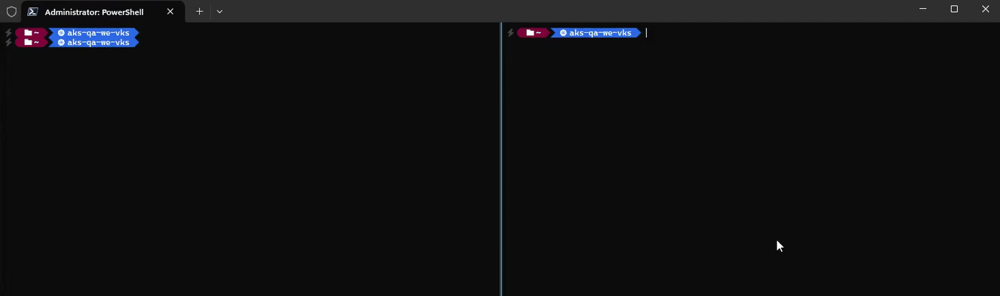

# `krp` - Kubernetes Reverse Proxy

[](https://www.nuget.org/packages/krp)
[](https://www.nuget.org/packages/dotnet-krp)
[](https://hub.docker.com/r/eddietisma/krp)

`krp` is a lightweight Kubernetes reverse proxy designed to provide on-demand port forwarding and seamless forwarding to internal Kubernetes resources. The tool facilitates automatic port forwards and provides dynamic routing via loopback addresses.

### **Features**
- **On-Demand Port Forwarding** – Automatically runs `kubectl port-forward` when you need it.
- **Context Aware** – Adapts to changes in your current cluster context.
- **Automatic Cleanup** – All active port forwards is cleaned up on application exit.
- **Dynamic Traffic Routing** – Routes through `localhost` using hosts file or [WinDivert](https://github.com/basil00/WinDivert).
- **Zero Configuration** – Once running, the tool requires no further setup or user intervention.

### **Dependencies**
- [DnsClient](https://github.com/MichaCo/DnsClient.NET) – DNS lookups for HTTP endpoints.
- [kubectl port-forward](https://kubernetes.io/docs/reference/kubectl/generated/kubectl_port-forward/) – Forwards pod ports to local ports.
- [kubernetes-client/csharp](https://github.com/kubernetes-client/csharp) – Tracks context changes and discovers endpoints.
- [Spectre.Console](https://github.com/spectreconsole/spectre.console/) – Enables an interactive and visually rich terminal user interface.
- [windivert](https://github.com/basil00/WinDivert) – Intercepts DNS requests for Kubernetes hostnames and redirects traffic to `krp`.
- [YARP](https://github.com/dotnet/yarp/) – Provides dynamic HTTP(S) routing.

## **How `krp` works**

1. **Endpoint registration**:  
   Uses static configuration or dynamic discovery for endpoints.

3. **Routing configuration:**  
   Each endpoint will get a unique loopback address (eg. `127.0.0.x myapi.namespace`).

5. **Reverse proxying:**  
   Listens on the local machine and proxies requests to endpoint targets.
   
7. **Port forwarding endpoints:**  
   Runs `kubectl port-forward` and forwards traffic to Kubernetes pods to local ports. Re-uses existing process if already exists, and if the pod dies the process also dies in which case a new one will spawn on-demand.
        
9. **HTTP proxy endpoints:**  
    Routes to local port if up, otherwise routes to original IP.

## Examples 



### Use case: Kubernetes endpoint

```
.UseEndpoint(0, 80, "namespace", "service/myapi") // 0 for dynamic local port selection
```

- Assume your cluster has a service exposed at `myapi.namespace:80`. 
- The DNS will be modified to resolve `myapi.namespace` to `127.0.0.x` (using hosts file or WinDivert).
- Traffic will be proxied to `krp`.
- `krp` will find corresponding target endpoint based on loopback address and run `kubectl port-forward` to forward traffic to local port.
- You can then make requests as if the service was hosted locally: `curl myapi.namespace`

### Use case: HTTP proxy endpoint

```
.UseHttpEndpoint(5001, "http", "domain.com", "api/service/v2")
```

- Assume your API gateway is using `domain.com/api/service/v2`. 
- The DNS will be modified to resolve `domain.com` to `127.0.0.x` (using hosts file or WinDivert).
- Traffic will be proxied to `krp`.
- `krp` will find corresponding service based on loopback address and forwards traffic to local port 5001 if up.
- You can then make requests to the URL which will be proxied locally: `curl domain.com/api/service/v2`

## **Getting started** 🚀

### Prerequisites
- `kubectl` must be installed and authenticated against your Kubernetes cluster.
- `hosts` file modifications requires administrator privileges.
- `windivert` for Windows Packet Filter driver requires administrator privileges.

### Installation

```bash
# Using winget
winget install EddieTisma.Krp
```

```bash
# Using dotnet tool
dotnet tool install --global dotnet-krp
krp
```

```bash
# Using docker
curl -fsSL https://raw.githubusercontent.com/eddietisma/krp/main/docker-compose.yml -o docker-compose.yaml
docker compose up
```

```bash
# Using local code
git clone https://github.com/eddietisma/krp.git
cd krp
dotnet run
```

## **Usage**

### Configuration

You can configure port-forwarding and routing behavior as follows:

```bash
# krp --help
Usage: krp [options]

Options:
  -v|--version                   Show version information.
  -n|--nameserver <NAMESERVERS>  DNS server, used for HTTP proxy endpoints
                                 Default value is: 8.8.8.8.
  --no-certificate-validation    Disable certificate validation
  --no-discovery                 Disable automatic Kubernetes endpoint discovery
  --no-ui                        Disable terminal UI
  -f|--forwarder <FORWARDER>     Forwarding method
                                 Allowed values are: tcp, http, hybrid.
                                 Default value is: hybrid.
  -r|--routing <ROUTING>         Routing method
                                 Allowed values are: hosts, windivert, dnsmasq.
                                 Default value is: windivert.
  -?|-h|--help                   Show help information.

Commands:
  https                          Manage HTTPS certificates

Environment variables:
  KRP_HOSTS                       Override path to hosts file
  KRP_DNSMASQ_OVERRIDE            Override path to dnsmasq configuration file
  KRP_DNSMASQ_RESTART_COMMAND     Executable used to restart dnsmasq
  KRP_DNSMASQ_RESTART_ARGUMENTS   Arguments passed to the restart executable
```

### Routing methods

#### `hosts`
1. Modifies system hosts file (eg. `C:\Windows\System32\drivers\etc\hosts` on Windows).
1. Each endpoint gets a unique loopback IPs (e.g., `127.0.0.x`).
1. Network traffic destined for these loopback IPs is intercepted and redirected to `krp`.

**Requirements**
- Requires administrator privileges to modify the hosts file.
- Requires administrator privileges when running in docker.
- Requires a mounted path and env variable `KRP_HOSTS` when running in docker.

#### `windivert` (**default**)

[WinDivert](https://github.com/basil00/WinDivert) is a Windows packet capture and manipulation tool used by `krp` to implement a transparent UDP proxy for the DNS protocol. It redirect DNS traffic for endpoint hostnames. When enabled, WinDivert allows `krp` to dynamically reroute traffic to loopback addresses.

1. Captures outgoing DNS requests (UDP/53) matching endpoints hostnames.
1. Crafts DNS responses to resolve these hostnames to unique loopback IPs (e.g., `127.0.0.x`).
1. Network traffic destined for these loopback IPs is intercepted and redirected to `krp`.

**Requirements**
- Only supported on Windows.
- Running WinDivert requires administrator privileges to capture and inject network packets.

> [!NOTE]
> WinDiverts installs as an ephemeral windows driver service at runtime. Once stopped, it's automatically removed.

#### `dnsmasq`

Writes endpoint mappings as native dnsmasq configuration, for example
`address=/myapp.local/127.0.0.2`. These directives also match subdomains.
The default output path is `/run/dnsmasq/krp.override.conf`, configurable with
`KRP_DNSMASQ_OVERRIDE`.

After configuration changes, `krp` runs the executable specified by
`KRP_DNSMASQ_RESTART_COMMAND`, with optional `KRP_DNSMASQ_RESTART_ARGUMENTS`.
The command must restart dnsmasq: `--conf-dir` files are read at startup, and
SIGHUP does not reread configuration files. On exit, `krp` removes its generated
file and runs the restart command again.

**Requirements**
- dnsmasq installed and configured to read the output directory, for example `conf-dir=/run/dnsmasq` in `dnsmasq.conf`.
- Write access to the output file and directory. A missing output directory is created.
- A configured restart executable and permission to run it successfully.

Example for a systemd service, with permission to restart dnsmasq:

```bash
export KRP_DNSMASQ_OVERRIDE=/run/dnsmasq/krp.override.conf
export KRP_DNSMASQ_RESTART_COMMAND=systemctl
export KRP_DNSMASQ_RESTART_ARGUMENTS="restart dnsmasq"
krp --routing dnsmasq
```

The restart executable is invoked directly, without a shell. Use a wrapper
script when restarting dnsmasq requires additional steps. The command has a
30-second timeout, and failures are reported as errors.

### Forwarders available

#### `HttpForwarder`
- Supports HTTP requests (only).
- Supports domain based routing (using HTTP headers).
- Multiplexing HTTP/1.1 and HTTP/2 over cleartext using same port without TLS [is not supported](https://learn.microsoft.com/en-us/aspnet/core/grpc/aspnetcore?view=aspnetcore-8.0&tabs=visual-studio#protocol-negotiation).
   - https://github.com/dotnet/aspnetcore/issues/13502.
- Uses SSL termination.
  - For HTTPS either disable certificate validation on client or setup certificate for each domain.

#### `TcpForwarder`
- Supports low-level TCP requests.
- Supports domain based routing (using domain-based IP per hostname in hosts file).

#### `TcpWithHttpForwarder` (**default**)
- Supports low-level TCP requests.
- Supports domain based routing (using domain-based IP per hostname in hosts file)
- Forwards HTTP/x request to `HttpForwarder` using packet inspection.
  - Inspects TCP traffic and routes HTTP requests to different server ports based on protocol (81 for HTTP/1.1 and 82 for HTTP/2) without TLS requirement.

> [!NOTE]
> **When running Docker on Windows:** No support for domain based routing **for low-level TCP** due to docker networking limitations. Windows do not yet have full support for host network driver, which results in NAT issues when routing (all loopback IPs will originate from Docker gateway). Limiting routing to HTTP requests only for Windows hosts.
>
> For HTTPS we could use SNI to detect hostnames and use for routing but ran into issues with reacting to network changes due to already established TCP tunnels (need some more work to break existing TCP connections when needed).

### HTTPS certificate management

`krp` uses its own certificate authority (CA) for optional local HTTPS routing.
- Run `krp https --trust` to create a new certificate and trust it.
- When HTTPS requests are proxied, `krp` dynamically generates per-host leaf certificates signed by that CA, so each routed hostname gets a valid certificate.

## **Running in Docker**

To run `krp` in a Docker container, follow these steps:

1. **Start Docker Desktop** as an administrator (required for hosts file modification).
2. **Build and run the Docker container:**
   ```cli
   docker buildx bake -f .buildcharts\docker-bake.hcl docker
   docker compose up -d
   ```

3. **Authenticate kubectl with cluster:**  
   Most providers will encrypt the auth config for the specific machine. Hence mounting the config folder won't work inside the container.
   ```bash
   # For AKS
   docker exec -it $(docker ps --filter "name=krp" --format "{{.ID}}") az login  --use-device-code
   docker exec -it $(docker ps --filter "name=krp" --format "{{.ID}}") kubelogin convert-kubeconfig -l azurecli

   # For GKE
   todo..

   # For EKS
   todo...
   ```
4. **Setup HTTPS:**
    - `krp https --trust`
    - `krp https --export /root/.krp/krp.pfx -p "your-cert-password"`
    - Install the exported CA cert on the host machine's trust store.
    - Note the CA is created inside the container, so you must export it and import on the host.

### Example `docker-compose.yml`

```yaml
services:
  krp:
    image: eddietisma/krp:latest
    container_name: krp
    restart: unless-stopped
    ports:
      - "80:80"
      - "443:443" # optional
    environment:
      AZURE_CONFIG_DIR: /root/.krp/.azure
      KRP_HOSTS: /mnt/etc
    volumes:
      - ~/.kube:/root/.kube
      - ~/.krp:/root/.krp
      - /c/Windows/System32/drivers/etc/:/mnt/etc/ # win
      # - /etc/:/mnt/etc/ # linux/mac
```

## Roadmap / Ideas
- [ ] Add integration tests.
- [x] Auto-discovery of Kubernetes services.
- [x] Support for low-level TCP traffic.
- [ ] Support for low-level UDP traffic.
- [ ] Support for translating internal Kubernetes IPs.
- [x] Eliminate hosts file dependency using **WinDivert**/**PF**/**iptables** (or mitmproxy) for more flexible routing.
- [x] Cross-platform support (Linux/macOS).
- [x] User interface.
- [x] Add GIF recordings of terminal use cases in README.
